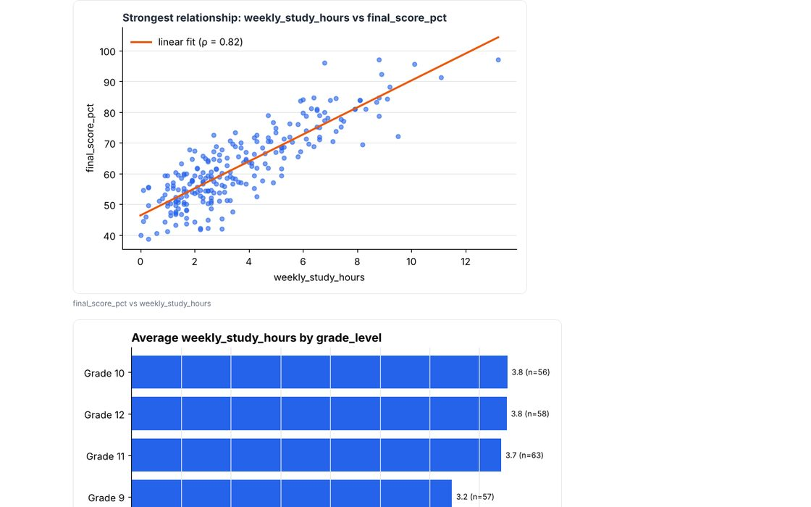

# 📊 DataMind — automated data analysis

Give DataMind a messy CSV, Excel, or JSON file. It cleans the data (and logs every change), profiles each column, runs the statistics, finds patterns worth knowing, draws charts, and writes a self-contained HTML report in plain language with the evidence and caveats behind each claim.



## My role & contributions

**Solo developer · AI-assisted**

- Designed the cleaning steps and the change log that records every edit to the data
- Chose robust statistics (Spearman, Kruskal–Wallis, Theil–Sen) so outliers don't create fake findings
- Tested it on pure random noise to confirm it reports nothing there

**Language:** Python (pandas, NumPy, SciPy, matplotlib)
**Shows:** data cleaning, statistics, visualization, and careful analytical reasoning.

## Quick start
```bash
pip install -r requirements.txt
python -m datamind samples                                   # two sample datasets in samples/
python -m datamind analyze samples/study_habits.csv          # → datamind_report/report.html
python -m datamind profile any.csv                           # column types and missing values
python -m datamind clean any.csv clean.csv                   # cleaned CSV + log
python -m pytest -q                                          # 7 tests
```

## Pipeline
1. **Import:** CSV, TSV, Excel, or JSON, read as text so nothing is mis-parsed before inspection.
2. **Clean** (`clean.py`), with every step logged:
   - `snake_case` column names (`"PM2.5 (µg/m³)"` → `pm2_5_ug_m3`)
   - placeholders (`N/A`, `-`, `?`, blank) → missing
   - empty rows/columns and duplicates removed
   - type inference: numbers (`$1,200`, `35%`), dates, yes/no, categories
   - inconsistent spellings unified (`grade 10` → `Grade 10`)
   - optional median/mode imputation (`--impute`)
3. **Analyze** (`analyze.py`):
   - summary statistics with skew and missing counts
   - Pearson **and** Spearman correlations (Spearman resists outliers)
   - group differences via Kruskal–Wallis plus effect size in standard deviations
   - time trends via the Theil–Sen slope and Kendall's τ (robust to outliers)
   - extreme outliers (3×IQR), skew, and missing-data warnings
4. **Report** (`report.py`, `viz.py`): ranked findings, distributions, a Spearman correlation heatmap, the strongest relationship as a scatter with a fit line, time series with a rolling average, and group bars. Everything is embedded in one HTML file, plus a Markdown version.

## Avoiding false discoveries
- A strict significance level (0.01), because many column pairs are tested at once.
- A minimum effect size: tiny but "significant" differences aren't reported.
- Every finding prints its evidence (r, ρ, p, n, effect size) and a caveat ("correlation is not causation", "check before removing outliers").
- **Tested on pure random noise: zero correlation, group, or trend findings.**
- Tested on the synthetic study-habits data: it finds the real study-time effect, flags the deliberate `95 hours/day` typo, and correctly says *nothing* about grade level, which has no effect in that data.

## Example output
See `docs/example_report/` (study habits) and `docs/example_report_air/` (air quality: downward trend, weekday traffic effect, wind relationship, and a wildfire-smoke outlier).

Both sample datasets are **synthetic and fictional**, with documented messiness (see `datamind/samples.py`).

## License

**Permission required.** © 2026 Dagmawi Melaku. You need my written permission before using, copying, or modifying this code, and any approved use must credit me with a link to this repository. Viewing, forking on GitHub, and running it to judge or review a submission are allowed without asking. To ask, [open an issue](../../issues/new). See [LICENSE](LICENSE) for the full terms.
