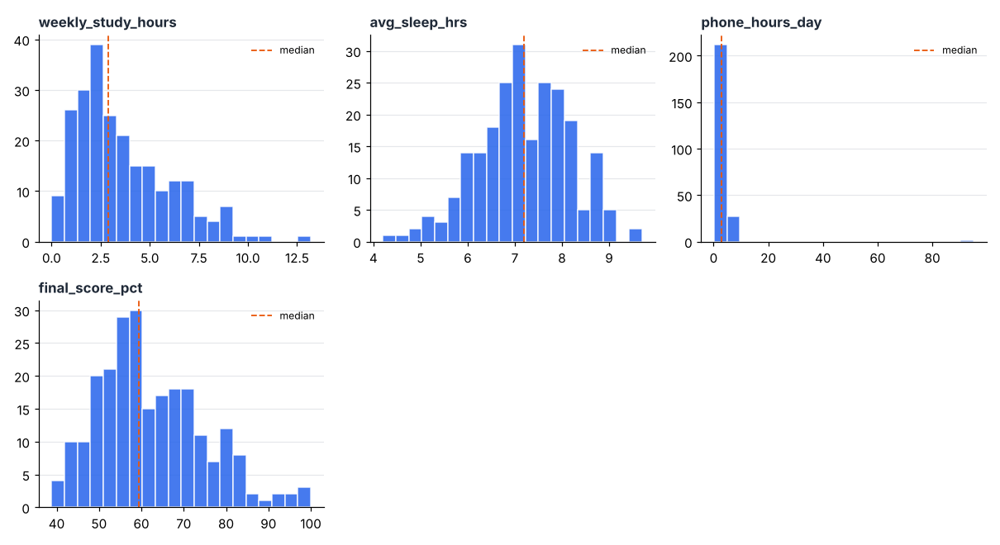
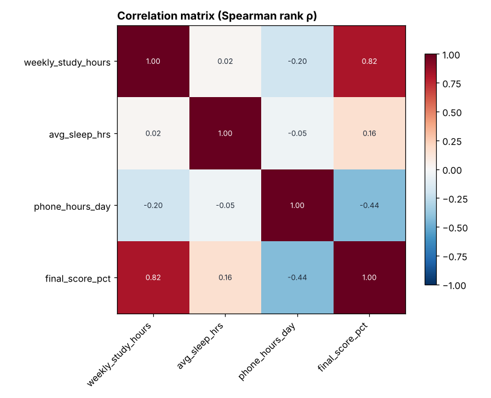
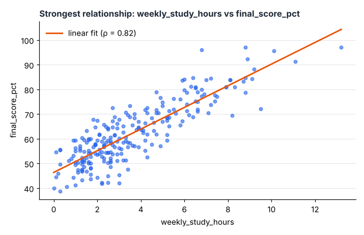
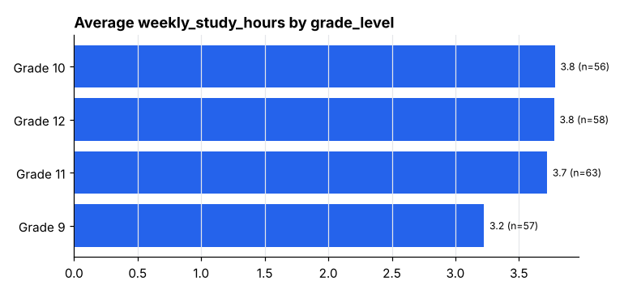

# Study Habits
_DataMind report · 2026-11-07_

240 rows × 7 columns

## Key findings
1. **final_score_pct rises as weekly_study_hours increases (very strong relationship).** — Pearson r = 0.86, Spearman ρ = 0.82, p = 2.5e-68, n = 234 _(Correlation is not causation; another factor may drive both.)_
2. **phone_hours_day has 1 extreme value(s): 95.** — more than 3×IQR beyond the quartiles (median 2.8) _(Check whether these are data-entry errors or real cases before removing them.)_
3. **final_score_pct falls as phone_hours_day increases (moderate relationship). Rank correlation is stronger than Pearson, which suggests outliers or a curved relationship.** — Pearson r = -0.15, Spearman ρ = -0.44, p = 1.4e-12, n = 240 _(Correlation is not causation; another factor may drive both.)_
4. **phone_hours_day is right-skewed, so the median (2.8) describes a typical value better than the mean (3.33).** — skewness 14.01

## Cleaning log
- Renamed columns to snake_case: 'Student ID'→student_id, 'Grade Level'→grade_level, 'Weekly Study Hours'→weekly_study_hours, 'Avg Sleep (hrs)'→avg_sleep_hrs, 'Phone Hours/Day'→phone_hours_day, 'Club Member'→club_member, 'Final Score %'→final_score_pct, ' notes '→notes
- Treated 259 placeholder values (blank, 'N/A', '-', '?', …) as missing
- Dropped empty column(s): notes
- Removed 3 duplicate row(s)
- 'grade_level': unified 12 inconsistent capitalization(s)
- 'weekly_study_hours' → numeric
- 'avg_sleep_hrs' → numeric
- 'phone_hours_day' → numeric
- 'club_member' → yes/no
- 'final_score_pct' → numeric

## Charts

