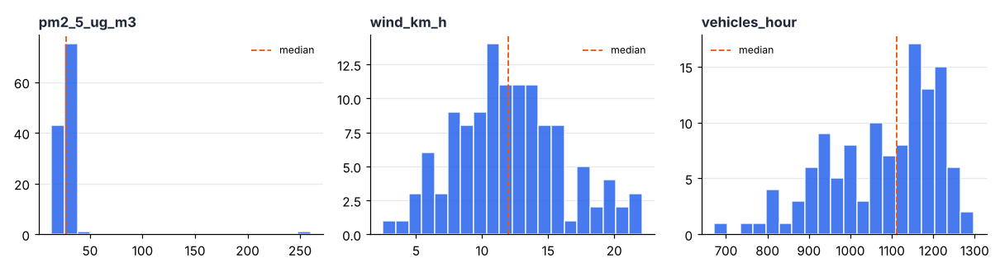
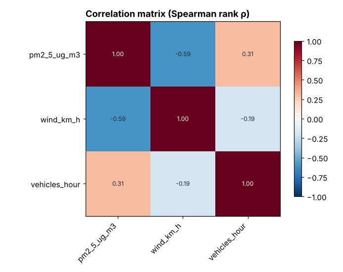
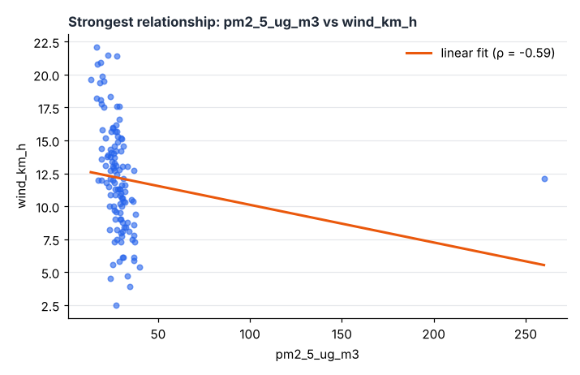
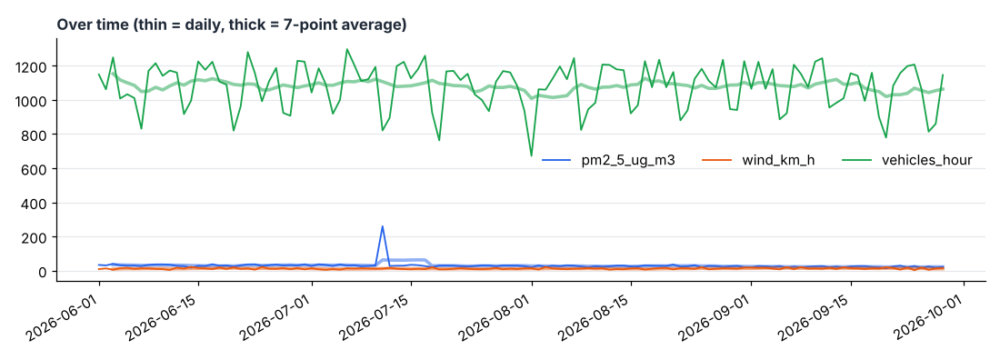
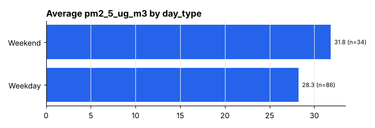

# City Air Quality
_DataMind report · 2026-11-07_

120 rows × 5 columns

## Key findings
1. **vehicles_hour differs by day_type: highest for 'Weekday' (1147.10), lowest for 'Weekend' (906.50).** — Kruskal–Wallis p = 1.1e-16; difference ≈ 1.81 standard deviations _(Groups may differ in other ways too (confounding).)_
2. **pm2_5_ug_m3 decreased over time by about 11.33 (41%) across the period.** — Theil–Sen slope -0.095/day, Kendall τ = -0.45, p = 4.0e-13 _(A straight-line trend can hide seasonal cycles.)_
3. **wind_km_h falls as pm2_5_ug_m3 increases (moderate relationship). Rank correlation is stronger than Pearson, which suggests outliers or a curved relationship.** — Pearson r = -0.15, Spearman ρ = -0.59, p = 1.4e-12, n = 120 _(Correlation is not causation; another factor may drive both.)_
4. **pm2_5_ug_m3 has 1 extreme value(s): 260.** — more than 3×IQR beyond the quartiles (median 27.45) _(Check whether these are data-entry errors or real cases before removing them.)_
5. **vehicles_hour rises as pm2_5_ug_m3 increases (weak relationship). Rank correlation is stronger than Pearson, which suggests outliers or a curved relationship.** — Pearson r = -0.08, Spearman ρ = 0.31, p = 6.6e-04, n = 120 _(Correlation is not causation; another factor may drive both.)_
6. **pm2_5_ug_m3 is right-skewed, so the median (27.45) describes a typical value better than the mean (29.27).** — skewness 10.01

## Cleaning log
- Renamed columns to snake_case: 'Date'→date, 'PM2.5 (µg/m³)'→pm2_5_ug_m3, 'Wind km/h'→wind_km_h, 'Vehicles/hour'→vehicles_hour, 'Day Type'→day_type
- 'date' → date
- 'pm2_5_ug_m3' → numeric
- 'wind_km_h' → numeric
- 'vehicles_hour' → numeric

## Charts

